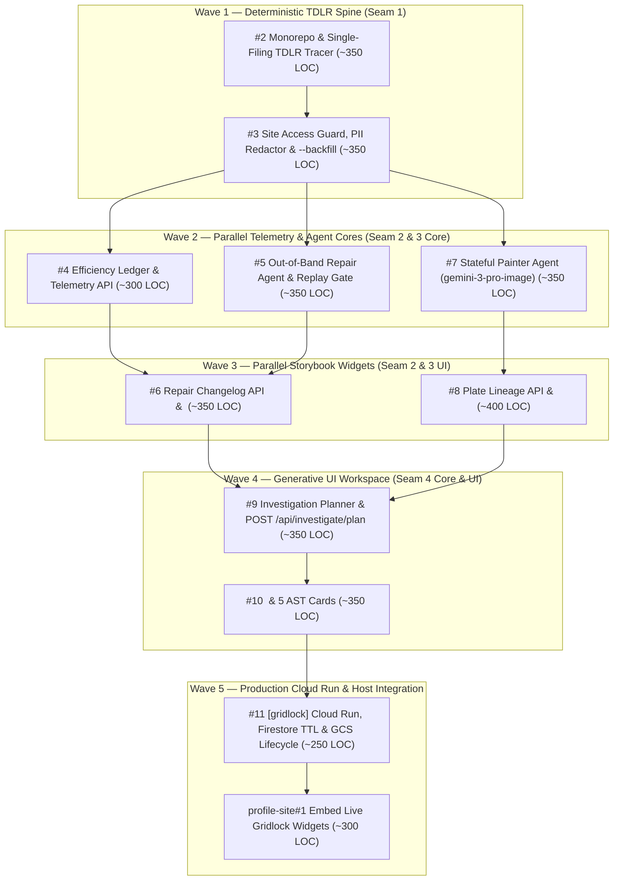

# Gridlock — Execution Roadmap (`ROADMAP.md`)

> **Parent Specification**: [`samasastudio/gridlock#1`](https://github.com/samasastudio/gridlock/issues/1)  
> **Architecture & Domain**: [`GLOSSARY.md`](./GLOSSARY.md) · [`ADR-0001`](./docs/adr/0001-two-repo-google-cloud-topology.md) · [`ADR-0002`](./docs/adr/0002-firestore-and-cloud-storage-spine.md) · [`ADR-0003`](./docs/adr/0003-deterministic-first-bounded-ai.md) · [`TDLR Site Access & Cadence`](./docs/connectors/tdlr-site-access-and-cadence.md)

---

## Quick Session Pickup (Find Unblocked Frontier)

At the start of any coding session, run this command to query GitHub's native dependency graph and list every open ticket whose `blocked_by` count is `0`:

```bash
gh api --paginate 'repos/samasastudio/gridlock/issues?state=open&labels=ready-for-agent' \
  --jq '.[] | select(.issue_dependencies_summary.blocked_by == 0) | "#\(.number): \(.title) (\(.html_url))"'
```

### Issue Close Quality Gate
**No issue may be closed until:**
1. Both its **Happy Path** and **Sad Path** automated test gates below pass (`npm test` green across the workspace).
2. Typechecking and linting pass with zero errors.
3. Its checkbox (`- [x]`) is updated in this `ROADMAP.md`.

---

## Dependency Graph



---

## Wave-by-Wave Ticket Order & Testing Validation Gates

### Wave 1 — Foundation & Deterministic Scraper (Seam 1)

- [x] **[`gridlock#2`](https://github.com/samasastudio/gridlock/issues/2) — Monorepo & Single-Filing TDLR TABS Tracer Bullet** (`~350 LOC`)
  - **Blocked by**: *None — **Ready to start immediately***
  - **Unlocks**: `#3`
  - **Delivers**: Bootstraps `packages/core` and `packages/widgets`, core `Project` / `Observation` / `SourceArtifact` / `ConnectorConfig` Zod schemas, and a Playwright + `<dl class="dl-horizontal">` parser extracting 1 frozen TDLR filing (`TABS2027003697`), storing a `.gz` SHA-256 **Source Artifact**, and short-circuiting on duplicate hash.
  - **Testing Validation Gate**:
    - [x] **Happy Path**: Extracts valid `Project` and append-only `Observation` records from frozen TDLR HTML (`TABS2027003697`) via `ConnectorConfig` `<dl class="dl-horizontal">` selectors, persists a gzipped `.gz` SHA-256 `SourceArtifact` (`expiresAt: null` when milestone-referenced, `+90d` when unreferenced), and short-circuits on a second identical run with `0` duplicate entity writes.
    - [x] **Sad Path**: Fails Zod invariant validation (`selector_anomaly`) when required `<dt>/<dd>` fields are missing or malformed (e.g., non-numeric `Estimated Cost` or missing `Project Number`), and aborts cleanly on empty/corrupted HTML payloads with zero partial `Project` or `Observation` writes.

- [ ] **[`gridlock#3`](https://github.com/samasastudio/gridlock/issues/3) — Site Access Guard, Ethical/PII Sanitizers & `--backfill` Discovery (Seam 1)** (`~350 LOC`)
  - **Blocked by**: [`#2`](https://github.com/samasastudio/gridlock/issues/2)
  - **Unlocks**: `#4`, `#5`, `#7` *(3 parallel tracks)*
  - **Delivers**: Adds `POST /TABS/Search/SearchProjects` discovery (`--backfill` + daily weekday mode), `verifySiteAccess` (`blocked_by_waf` vs. `selector_anomaly`, `robots.txt` / `429`), polite single-flight pacing (`GridlockCivicResearchBot/1.0`, `>= 1,500ms`), deterministic PII redaction, and opt-in `LIVE_ACCESS_TEST=1` smoke check.
  - **Testing Validation Gate**:
    - [ ] **Happy Path**: Discovers and ingests filings chronologically via `POST /TABS/Search/SearchProjects` using the transparent `GridlockCivicResearchBot/1.0` User-Agent and single-flight pacing (`maxConcurrency: 1`, `>= 1,500ms`), and deterministically redacts personal phone numbers, personal emails, and residential addresses while retaining corporate `OwnerName` / `FacilityName` / `DesignFirmName`.
    - [ ] **Sad Path**: `verifySiteAccess` immediately halts with `status: "blocked_by_waf"` and `0` Gemini tokens when served HTTP `403`/`429`/`503`, `robots.txt` disallow rules, `Retry-After` headers, Imperva `/_Incapsula_Resource` challenges, or Cloudflare Turnstile pages; enforces the `<= 100` records/run circuit breaker when discovery returns oversized result sets.

---

### Wave 2 — Parallel Telemetry & Agentic Cores (Seam 2 & Seam 3 Backend)

*(Once [`#3`](https://github.com/samasastudio/gridlock/issues/3) completes, `#4`, `#5`, and `#7` are all unblocked and can be tackled in any order or in parallel.)*

- [ ] **[`gridlock#4`](https://github.com/samasastudio/gridlock/issues/4) — Efficiency Ledger, Cloud Trace Spans & `GET /api/telemetry/efficiency`** (`~300 LOC`)
  - **Blocked by**: [`#3`](https://github.com/samasastudio/gridlock/issues/3)
  - **Unlocks**: `#6` (alongside `#5`)
  - **Delivers**: Records permanent per-run `telemetry_runs` (`~156 KB/year`) and cumulative `telemetry_summary` (`naiveTokensAvoided`, `execution_mode: "deterministic" | "agentic"` spans) and boots the HTTP service with `GET /api/telemetry/efficiency`.
  - **Testing Validation Gate**:
    - [ ] **Happy Path**: Deterministic runs (fresh extractions and content-hash short-circuits) atomically increment `naiveTokensAvoided` (`Math.ceil(rawByteLength / 4)`), `deterministicRunsCount`, and `estimatedCostSavedUsd`, write permanent `telemetry_runs` (`expiresAt: null`), emit `execution_mode: "deterministic"` spans, and return a schema-valid scorecard from `GET /api/telemetry/efficiency`.
    - [ ] **Sad Path**: Aborted or `blocked_by_waf` runs record failure telemetry without inflating `naiveTokensAvoided` or `deterministicRunsCount`; invalid query parameters or corrupted telemetry documents return structured `400`/`500` JSON errors rather than crashing the HTTP server.

- [ ] **[`gridlock#5`](https://github.com/samasastudio/gridlock/issues/5) — Out-of-Band Repair Agent & Sandbox Replay Gate (Seam 2 Core)** (`~350 LOC`)
  - **Blocked by**: [`#3`](https://github.com/samasastudio/gridlock/issues/3)
  - **Unlocks**: `#6` (alongside `#4`)
  - **Delivers**: On `selector_anomaly`, invokes `gemini-3.8-flash` (`interactions.create`) to synthesize a candidate `ConnectorConfig` patch, verifies 100% pass rate against historical fixtures + the quarantined artifact in the **Sandbox Replay Gate** (fail-closed), and records `RepairChangelogEntry` (`mttrMs`, `subsequentDeterministicRunsServed`).
  - **Testing Validation Gate**:
    - [ ] **Happy Path**: Feeding a mutated TDLR HTML fixture triggers `selector_anomaly`, invokes the **Repair Agent**, verifies the candidate selector patch against 100% of historical fixtures + the mutated artifact in the **Sandbox Replay Gate**, promotes the new `ConnectorConfig` version, writes a `RepairChangelogEntry` (`mttrMs`, `repairTokensUsed`), and increments `subsequentDeterministicRunsServed` on following deterministic sweeps.
    - [ ] **Sad Path (Fail-Closed)**: When the **Repair Agent** returns a candidate patch that fixes the quarantined artifact but regresses even 1 historical fixture—or returns malformed/unparseable JSON or times out—the **Sandbox Replay Gate** rejects the patch, leaves the connector in `selector_anomaly`, and performs zero config promotion or unverified data writes.

- [ ] **[`gridlock#7`](https://github.com/samasastudio/gridlock/issues/7) — Stateful Painter Agent (`gemini-3-pro-image`) & Lineage Chaining (Seam 3 Core)** (`~350 LOC`)
  - **Blocked by**: [`#3`](https://github.com/samasastudio/gridlock/issues/3)
  - **Unlocks**: `#8`
  - **Delivers**: Deterministic milestone gate (`imageGenerationsAvoided`), `bootstrapCanvas`, `paintMilestoneDelta` (`previous_interaction_id` chaining), `.webp` encoding, expired `interaction_id` fallback from cached `.webp` parent buffers, and `branchLineage` watermarked as `"Scenario Branch / Unverified Projection"`.
  - **Testing Validation Gate**:
    - [ ] **Happy Path**: Crossing a visual milestone executes Turn 1 `bootstrapCanvas` and Turn 2+ `paintMilestoneDelta` (passing `previous_interaction_id`), encodes `.webp` plates to Cloud Storage, links `VisualPlate` nodes in Firestore, and watermarks/labels `branchLineage` plates as `"Scenario Branch / Unverified Projection"`.
    - [ ] **Sad Path**: Non-milestone observations short-circuit at `0` image tokens (`imageGenerationsAvoided++`); if `@google/genai` rejects an expired `previous_interaction_id`, the agent automatically falls back to re-bootstrapping from the parent's cached `.webp` buffer in Cloud Storage without breaking the **Lineage**; empty/corrupt image responses fail closed without overwriting the active plate.

---

### Wave 3 — Parallel Embeddable Widgets in Storybook (Seam 2 & Seam 3 UI)

- [ ] **[`gridlock#6`](https://github.com/samasastudio/gridlock/issues/6) — `GET /api/repairs/changelog` & `<GridlockRepairLogWidget />` (Seam 2 UI)** (`~350 LOC`)
  - **Blocked by**: [`#4`](https://github.com/samasastudio/gridlock/issues/4), [`#5`](https://github.com/samasastudio/gridlock/issues/5)
  - **Unlocks**: `#9` (alongside `#8`)
  - **Delivers**: Exposes `GET /api/repairs/changelog` (JSON + Markdown) and ships `<GridlockRepairLogWidget />` in `@samasastudio/gridlock-widgets` with Storybook stories displaying selector diffs, MTTR, heal amortization, and the Efficiency Ledger scorecard.
  - **Testing Validation Gate**:
    - [ ] **Happy Path**: `GET /api/repairs/changelog` returns valid JSON and `?format=md` Markdown; `<GridlockRepairLogWidget />` renders the repair history, before/after selector diffs, `mttrMs`, `subsequentDeterministicRunsServed`, and **Efficiency Ledger** scorecard across diurnal and nocturnal themes.
    - [ ] **Sad Path**: Cleanly renders zero-anomaly empty states (`100% deterministic uptime`), active `selector_anomaly` / `blocked_by_waf` warning banners when a connector is degraded, and non-crashing error/retry states on HTTP `500` or network failure.

- [ ] **[`gridlock#8`](https://github.com/samasastudio/gridlock/issues/8) — Plate Lineage API & `<GridlockPlateWidget />` Scrubber (Seam 3 UI)** (`~400 LOC`)
  - **Blocked by**: [`#7`](https://github.com/samasastudio/gridlock/issues/7)
  - **Unlocks**: `#9` (alongside `#6`)
  - **Delivers**: Exposes `GET /api/plates/lineage` and `POST /api/plates/branch`, and ships `<GridlockPlateWidget />` in `@samasastudio/gridlock-widgets` with temporal scrubbing across `interaction_id` frames and scenario branch comparison in Storybook.
  - **Testing Validation Gate**:
    - [ ] **Happy Path**: `GET /api/plates/lineage` and `POST /api/plates/branch` return valid **Lineage** trees and new branched plates; `<GridlockPlateWidget />` scrubs across historical `interaction_id` frames, displays triggering **Observations** and SHA-256 **Source Artifact** citations, and toggles scenario branches with visible `"Scenario Branch / Unverified Projection"` badges.
    - [ ] **Sad Path**: `POST /api/plates/branch` rejects empty/oversized scenario prompts (`400`), unknown `interactionId` parents (`404`), and branch quota breaches (`429`); `<GridlockPlateWidget />` handles single-frame lineages, broken `.webp` asset URLs, and failed branch requests with graceful fallback UI.

---

### Wave 4 — Generative UI Workspace (Seam 4 Core & UI)

- [ ] **[`gridlock#9`](https://github.com/samasastudio/gridlock/issues/9) — Investigation Planner (`gemini-3.8-flash`) & `POST /api/investigate/plan` (Seam 4 Core)** (`~350 LOC`)
  - **Blocked by**: [`#6`](https://github.com/samasastudio/gridlock/issues/6), [`#8`](https://github.com/samasastudio/gridlock/issues/8)
  - **Unlocks**: `#10`
  - **Delivers**: Translates natural-language investigative queries and in-place workspace mutations into a Zod-validated `UI AST` restricted to the 5 curated Atlas Dossier components and hydrated strictly with real Firestore records and SHA-256 **Source Artifact** citations.
  - **Testing Validation Gate**:
    - [ ] **Happy Path**: `POST /api/investigate/plan` returns a Zod-validated `UI AST` using only the 5 permitted component types, with every metric and project prop deterministically hydrated from Firestore and paired with its SHA-256 `SourceArtifact` hash.
    - [ ] **Sad Path**: Rejects hallucinated/unknown component names (`z.enum` failure) or fabricated entity IDs absent from Firestore, returns a valid empty-state `UI AST` when a query matches zero records in Firestore (never inventing numbers), and returns `400` on empty or malformed query bodies.

- [ ] **[`gridlock#10`](https://github.com/samasastudio/gridlock/issues/10) — `<GridlockConsoleWidget />` & 5 Atlas Dossier AST Cards (Seam 4 UI)** (`~350 LOC`)
  - **Blocked by**: [`#9`](https://github.com/samasastudio/gridlock/issues/9)
  - **Unlocks**: `#11`
  - **Delivers**: Ships `<GridlockConsoleWidget />` and its 5 bounded AST components (`ProjectDossierCard`, `VisualPlateScrubber`, `ObservationTimeline`, `MetricComparisonTable`, `ConnectorHealthCard`) in `@samasastudio/gridlock-widgets` with Storybook interaction tests.
  - **Testing Validation Gate**:
    - [ ] **Happy Path**: Renders all 5 **UI AST** components from a planner response, supports in-place workspace refinement without a chat transcript, and opens/links SHA-256 **Source Artifact** provenance citations across all cards.
    - [ ] **Sad Path**: Card-level error boundary isolates any malformed AST node without crashing the workspace, prevents duplicate concurrent query submissions while a request is in flight, and renders a clear error banner with retry when `POST /api/investigate/plan` returns `429`/`500`.

---

### Wave 5 — Production Google Cloud Spine & `profile-site` Integration

- [ ] **[`gridlock#11`](https://github.com/samasastudio/gridlock/issues/11) — Cloud Run Job/Service, Firestore TTL & GCS Lifecycle Spine** (`~250 LOC`)
  - **Blocked by**: [`#10`](https://github.com/samasastudio/gridlock/issues/10)
  - **Unlocks**: [`samasastudio/profile-site#1`](https://github.com/samasastudio/profile-site/issues/1)
  - **Delivers**: Containerizes `packages/core` for Cloud Run Job (`0 14 * * 1-5` UTC + `--backfill`) and Cloud Run Service, and codifies the 90-day Firestore TTL on unreferenced `source_artifacts` and GCS lifecycle rules on `/quarantine/` and `/branches/ephemeral/`.
  - **Testing Validation Gate**:
    - [ ] **Happy Path**: Container image builds and boots both the Cloud Run Job entrypoint and Cloud Run Service HTTP healthcheck; Firestore TTL and GCS lifecycle configs validate cleanly and target only unreferenced `source_artifacts.expiresAt`, `/quarantine/`, and `/branches/ephemeral/`.
    - [ ] **Sad Path**: Container entrypoint fails fast with explicit diagnostic errors when required GCP/Gemini environment variables are missing; automated config checks verify that canonical collections (`projects`, `observations`, `repair_changelog`, `telemetry_summary`, `telemetry_runs`) and milestone-referenced `source_artifacts` (`expiresAt: null`) are exempt from 90-day deletion.

- [ ] **[`profile-site#1`](https://github.com/samasastudio/profile-site/issues/1) — Embed Live Gridlock Widgets in Atlas Dossier & Field Notes** (`~300 LOC`, in `samasastudio/profile-site`)
  - **Blocked by**: [`samasastudio/gridlock#11`](https://github.com/samasastudio/gridlock/issues/11)
  - **Delivers**: Consumes `@samasastudio/gridlock-widgets` in `profile-site`, configures Firebase Hosting `/api/**` rewrites, and replaces static mock data in `/work/gridlock` and Field Notes with the 3 live widgets.
  - **Testing Validation Gate**:
    - [ ] **Happy Path**: `profile-site` builds and renders `<GridlockPlateWidget />`, `<GridlockConsoleWidget />`, and `<GridlockRepairLogWidget />` in `/work/gridlock` and Field Notes with full diurnal/nocturnal CSS custom property inheritance (`--paper`, `--ink`) and working `/api/**` rewrites.
    - [ ] **Sad Path**: When `/api/**` endpoints are offline, slow, or return `500`, each widget degrades gracefully inside its own skeleton/error boundary without breaking `profile-site` routing, essays, or page layout.
