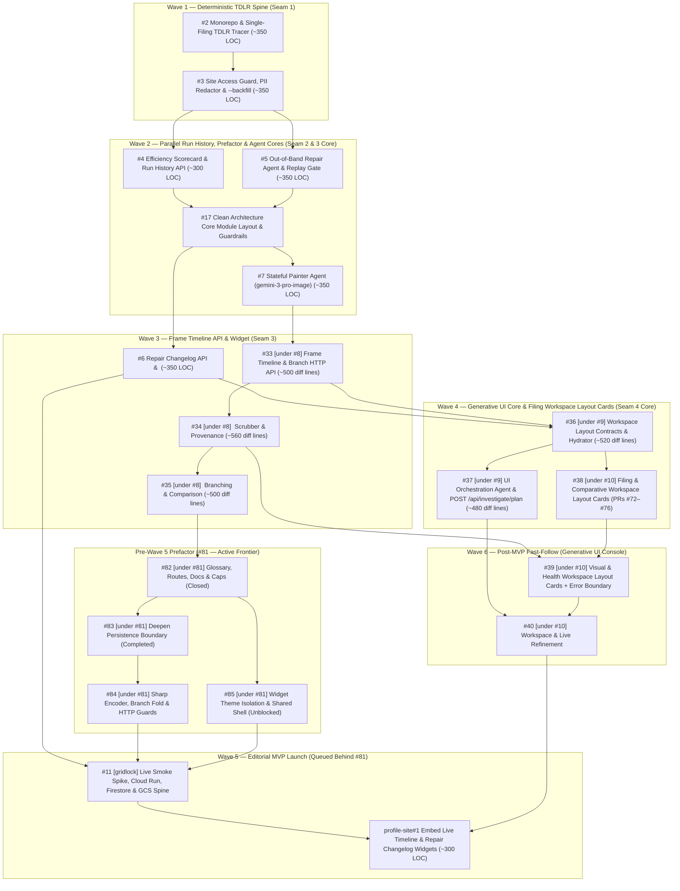

# Gridlock — Execution Roadmap (`ROADMAP.md`)

> **Parent Specification**: [`samasastudio/gridlock#1`](https://github.com/samasastudio/gridlock/issues/1)  
> **Architecture & Domain**: [`GLOSSARY.md`](./GLOSSARY.md) · [`ADR-0001`](./docs/adr/0001-two-repo-google-cloud-topology.md) · [`ADR-0002`](./docs/adr/0002-firestore-and-cloud-storage-spine.md) · [`ADR-0003`](./docs/adr/0003-deterministic-first-bounded-ai.md) · [`ADR-0004`](./docs/adr/0004-clean-architecture-core-module-layout.md) · [`TDLR Site Access & Cadence`](./docs/connectors/tdlr-site-access-and-cadence.md)

---

## Quick Session Pickup (Find Unblocked Frontier)

At the start of any coding session, run this command to query GitHub's native dependency graph and list every open ticket whose `blocked_by` count is `0`:

```bash
gh api --paginate 'repos/samasastudio/gridlock/issues?state=open' \
  --jq '.[] | select(.pull_request == null and .issue_dependencies_summary.blocked_by == 0) | "#\(.number): \(.title) (\(.html_url))"'
```

### Issue Close Quality Gate
**No issue may be closed until:**
1. Both its **Happy Path** and **Sad Path** automated test gates below pass (`npm test` green across the workspace).
2. Typechecking and linting pass with zero errors.
3. Its checkbox (`- [x]`) is updated in this `ROADMAP.md`.

---

## Editorial MVP Cut Line (Anti-Drift Scope)

Gridlock is an **editorial civic publishing pipeline**, not a high-QPS platform. All core backend waves (`#2`–`#9`, `#17`, `#33`–`#37`) and two embeddable widgets (`<GridlockRepairChangelogWidget />` and `<GridlockTimelineWidget />`) are already merged on `main`. To ship a live public artifact quickly and retire external I/O risk:

- **Pre-Wave 5 Prefactor ([`gridlock#81`](https://github.com/samasastudio/gridlock/issues/81) — Active Frontier)**:
  - [x] [`#82`](https://github.com/samasastudio/gridlock/issues/82) — Glossary alignment, public routes, docs, widget exports, and `400`/`280`-line caps *(completed & closed)*.
  - [x] [`#83`](https://github.com/samasastudio/gridlock/issues/83) — Deepen persistence boundary for atomic transitions and bounded reads *(completed)*.
  - [x] [`#84`](https://github.com/samasastudio/gridlock/issues/84) — Collapse illustration encoder onto `sharp`, fold Scenario Branch wrapper, and unify HTTP guards *(completed)*.
  - [x] [`#85`](https://github.com/samasastudio/gridlock/issues/85) — Isolate widget theme tokens, deduplicate base CSS, and extract shared snapshot loading shell *(completed)*.
- **In MVP (Wave 5 — Queued Behind `#81`)**:
  - Execute the remaining **4-Step `#11` Live Smoke Spike** slices (`Slices 2–5`) and deploy the Cloud Run Service + daily/backfill Job + Firestore/GCS spine (`#11` is **no longer blocked by `#39`/`#40`**).
  - Mount the two already-built live widgets (`<GridlockTimelineWidget />` and `<GridlockRepairChangelogWidget />`) on `/work/gridlock` in `profile-site` with Firebase `/api/**` rewrites (`profile-site#1`).
  - Treat the Out-of-Band Repair Agent (`#5`) as an on-demand utility invoked only when a real `selector_anomaly` occurs, without adding extra automated retry infrastructure.
- **Deferred to Post-MVP Fast-Follow (Wave 6)**:
  - `#39` (Visual & Health Workspace Layout Cards + Error Boundary) and `#40` (`<GridlockConsoleWidget />` Generative UI Workspace).
  - Embedding `<GridlockConsoleWidget />` and secondary Field Notes multi-essay widgets in `profile-site`.

---

## Dependency Graph



---

## Wave-by-Wave Ticket Order & Testing Validation Gates

### Wave 1 — Foundation & Deterministic Scraper (Seam 1)

- [x] **[`gridlock#2`](https://github.com/samasastudio/gridlock/issues/2) — Monorepo & Single-Filing TDLR TABS Tracer Bullet** (`~350 LOC`)
  - **Blocked by**: *None — **Ready to start immediately***
  - **Unlocks**: `#3`
  - **Delivers**: Bootstraps `packages/core` and `packages/widgets`, core `Project` / `Observation` / `RawCapture` / `ConnectorConfig` Zod schemas, and a Playwright + `<dl class="dl-horizontal">` parser extracting 1 frozen TDLR filing (`TABS2027003697`), storing a `.gz` SHA-256 **Raw Capture**, and short-circuiting on duplicate hash.
  - **Testing Validation Gate**:
    - [x] **Happy Path**: Extracts valid `Project` and append-only `Observation` records from frozen TDLR HTML (`TABS2027003697`) via `ConnectorConfig` `<dl class="dl-horizontal">` selectors, persists a gzipped `.gz` SHA-256 `RawCapture` (`expiresAt: null` when milestone-referenced, `+90d` when unreferenced), and short-circuits on a second identical run with `0` duplicate entity writes.
    - [x] **Sad Path**: Fails Zod invariant validation (`selector_anomaly`) when required `<dt>/<dd>` fields are missing or malformed (e.g., non-numeric `Estimated Cost` or missing `Project Number`), and aborts cleanly on empty/corrupted HTML payloads with zero partial `Project` or `Observation` writes.

- [x] **[`gridlock#3`](https://github.com/samasastudio/gridlock/issues/3) — Site Access Guard, Ethical/PII Sanitizers & `--backfill` Discovery (Seam 1)** (`~350 LOC`)
  - **Blocked by**: [`#2`](https://github.com/samasastudio/gridlock/issues/2)
  - **Unlocks**: `#4`, `#5`, `#7` *(3 parallel tracks)*
  - **Delivers**: Adds `POST /TABS/Search/SearchProjects` discovery (`--backfill` + daily weekday mode), `verifySiteAccess` (`blocked_by_waf` vs. `selector_anomaly`, `robots.txt` / `429`), polite single-flight pacing (`GridlockCivicResearchBot/1.0`, `>= 1,500ms`), deterministic PII redaction, and opt-in `LIVE_ACCESS_TEST=1` smoke check.
  - **Testing Validation Gate**:
    - [x] **Happy Path**: Discovers and ingests filings chronologically via `POST /TABS/Search/SearchProjects` using the transparent `GridlockCivicResearchBot/1.0` User-Agent and single-flight pacing (`maxConcurrency: 1`, `>= 1,500ms`), and deterministically redacts personal phone numbers, personal emails, and residential addresses while retaining corporate `OwnerName` / `FacilityName` / `DesignFirmName`.
    - [x] **Sad Path**: `verifySiteAccess` immediately halts with `status: "blocked_by_waf"` and `0` Gemini tokens when served HTTP `403`/`429`/`503`, `robots.txt` disallow rules, `Retry-After` headers, Imperva `/_Incapsula_Resource` challenges, or Cloudflare Turnstile pages; enforces the `<= 100` records/run circuit breaker when discovery returns oversized result sets.

---

### Wave 2 — Parallel Run History & Agentic Cores (Seam 2 & Seam 3 Backend)

*(Once [`#3`](https://github.com/samasastudio/gridlock/issues/3) completes, `#4`, `#5`, and `#7` are all unblocked and can be tackled in any order or in parallel.)*

- [x] **[`gridlock#4`](https://github.com/samasastudio/gridlock/issues/4) — Efficiency Scorecard, Cloud Trace Spans & `GET /api/efficiency/scorecard`** (`~300 LOC`)
  - **Blocked by**: [`#3`](https://github.com/samasastudio/gridlock/issues/3)
  - **Unlocks**: `#6` (alongside `#5`)
  - **Delivers**: Records permanent per-run `run_records` (`~156 KB/year`) and cumulative `efficiency_scorecard` (`naiveTokensAvoided`, `execution_mode: "deterministic" | "agentic"` spans) and boots the HTTP service with `GET /api/efficiency/scorecard`.
  - **Testing Validation Gate**:
    - [x] **Happy Path**: Deterministic runs (fresh extractions and content-hash short-circuits) atomically increment `naiveTokensAvoided` (`Math.ceil(rawByteLength / 4)`), `deterministicRunsCount`, and `estimatedCostSavedUsd`, write permanent `run_records` (`expiresAt: null`), emit `execution_mode: "deterministic"` spans, and return a schema-valid scorecard from `GET /api/efficiency/scorecard`.
    - [x] **Sad Path**: Aborted or `blocked_by_waf` runs record failure run records without inflating `naiveTokensAvoided` or `deterministicRunsCount`; invalid query parameters or corrupted scorecard documents return structured `400`/`500` JSON errors rather than crashing the HTTP server.

- [x] **[`gridlock#5`](https://github.com/samasastudio/gridlock/issues/5) — Out-of-Band Repair Agent & Sandbox Replay Gate (Seam 2 Core)** (`~350 LOC`)
  - **Blocked by**: [`#3`](https://github.com/samasastudio/gridlock/issues/3)
  - **Unlocks**: `#6` (alongside `#4`)
  - **Delivers**: On `selector_anomaly`, invokes `gemini-3.8-flash` (`interactions.create`) to synthesize a candidate `ConnectorConfig` patch, verifies 100% pass rate against historical fixtures + the quarantined Raw Capture in the **Sandbox Replay Gate** (fail-closed), and records `RepairChangelogEntry` (`mttrMs`, `subsequentDeterministicRunsServed`).
  - **Testing Validation Gate**:
    - [x] **Happy Path**: Feeding a mutated TDLR HTML fixture triggers `selector_anomaly`, invokes the **Repair Agent**, verifies the candidate selector patch against 100% of historical fixtures + the mutated Raw Capture in the **Sandbox Replay Gate**, promotes the new `ConnectorConfig` version, writes a `RepairChangelogEntry` (`mttrMs`, `repairTokensUsed`), and increments `subsequentDeterministicRunsServed` on following deterministic sweeps.
    - [x] **Sad Path (Fail-Closed)**: When the **Repair Agent** returns a candidate patch that fixes the quarantined Raw Capture but regresses even 1 historical fixture—or returns malformed/unparseable JSON or times out—the **Sandbox Replay Gate** rejects the patch, leaves the connector in `selector_anomaly`, and performs zero config promotion or unverified data writes.

- [x] **[`gridlock#17`](https://github.com/samasastudio/gridlock/issues/17) — Prefactor: Clean Architecture Module Layout & Guardrails in `packages/core`** (`ADR-0004`)
  - **Blocked by**: [`#4`](https://github.com/samasastudio/gridlock/issues/4), [`#5`](https://github.com/samasastudio/gridlock/issues/5)
  - **Unlocks**: `#6`, `#7`
  - **Delivers**: Reorganizes `@samasastudio/gridlock-core` into four Clean Architecture layers (`interfaces/`, `use-cases/` + `use-cases/helpers/`, `adapters/`, `controllers/`), extracts pure deterministic state transitions (`applyHealAmortization`, `applyConnectorPromotion`) from the repository adapter, deduplicates test fixtures and mock HTTP server harnesses, and enforces `<= 400` lines/file + inward layer imports in `scripts/lint-checks.mjs`.
  - **Testing Validation Gate**:
    - [x] **Happy Path**: All `@samasastudio/gridlock-core` modules live under `interfaces/`, `use-cases/` (and `use-cases/helpers/`), `adapters/`, or `controllers/`; all existing **Connector**, **Efficiency Scorecard**, and **Repair Agent** public-seam tests pass without breaking public exports; shared test fixtures and mock portal server helpers eliminate duplicated HTML fixtures across test suites.
    - [x] **Sad Path**: `npm run lint` (`evaluateSourceFileLintRules`) deterministically fails if any file under `packages/core/src` exceeds `400` lines, lives outside the four permitted layer directories (other than `src/index.ts`), uses `let` bindings or imperative `for` loops, or violates inward layer import seams (`interfaces/` importing from `use-cases/`/`adapters/`/`controllers/`, `adapters/` importing from `use-cases/`/`controllers/`, `use-cases/` or `use-cases/helpers/` importing from `adapters/`/`controllers/`, or `controllers/` importing from `use-cases/helpers/` or `adapters/`).

- [x] **[`gridlock#7`](https://github.com/samasastudio/gridlock/issues/7) — Stateful Painter Agent (`gemini-3-pro-image`) & Frame Timeline Chaining (Seam 3 Core)** (`~350 LOC`)
  - **Blocked by**: [`#3`](https://github.com/samasastudio/gridlock/issues/3), [`#17`](https://github.com/samasastudio/gridlock/issues/17)
  - **Unlocks**: `#8`
  - **Delivers**: Deterministic milestone gate (`imageGenerationsAvoided`), `bootstrapCanvas`, `paintMilestoneDelta` (`previous_interaction_id` chaining), `.webp` encoding, expired `interaction_id` fallback from cached `.webp` parent buffers, and Scenario Branch frames watermarked as `"Scenario Branch / Unverified Projection"`.
  - **Testing Validation Gate**:
    - [x] **Happy Path**: Crossing a visual milestone executes Turn 1 `bootstrapCanvas` and Turn 2+ `paintMilestoneDelta` (passing `previous_interaction_id`), encodes `.webp` illustrations to Cloud Storage, links `GeneratedIllustration` nodes in Firestore, and watermarks/labels Scenario Branch illustrations as `"Scenario Branch / Unverified Projection"`.
    - [x] **Sad Path**: Non-milestone observations short-circuit at `0` image tokens (`imageGenerationsAvoided++`); if `@google/genai` rejects an expired `previous_interaction_id`, the agent automatically falls back to re-bootstrapping from the parent's cached `.webp` buffer in Cloud Storage without breaking the **Frame Timeline**; empty/corrupt image responses fail closed without overwriting the active illustration.

---

### Wave 3 — Parallel Embeddable Widgets in Storybook (Seam 2 & Seam 3 UI)

- [x] **[`gridlock#6`](https://github.com/samasastudio/gridlock/issues/6) — `GET /api/repairs/changelog` & `<GridlockRepairChangelogWidget />` (Seam 2 UI)** (`~350 LOC`)
  - **Blocked by**: [`#4`](https://github.com/samasastudio/gridlock/issues/4), [`#5`](https://github.com/samasastudio/gridlock/issues/5), [`#17`](https://github.com/samasastudio/gridlock/issues/17)
  - **Unlocks**: `#9` (alongside `#8`)
  - **Delivers**: Exposes `GET /api/repairs/changelog` (JSON + Markdown) and ships `<GridlockRepairChangelogWidget />` in `@samasastudio/gridlock-widgets` with Storybook stories displaying selector diffs, MTTR, heal amortization, and the Efficiency Scorecard.
  - **Testing Validation Gate**:
    - [x] **Happy Path**: `GET /api/repairs/changelog` returns valid JSON and `?format=md` Markdown; `<GridlockRepairChangelogWidget />` renders the repair history, before/after selector diffs, `mttrMs`, `subsequentDeterministicRunsServed`, and **Efficiency Scorecard** across diurnal and nocturnal themes.
    - [x] **Sad Path**: Cleanly renders zero-anomaly empty states (`100% deterministic uptime`), active `selector_anomaly` / `blocked_by_waf` warning banners when a connector is degraded, and non-crashing error/retry states on HTTP `500` or network failure.

- [x] **[`gridlock#8`](https://github.com/samasastudio/gridlock/issues/8) — Frame Timeline API & `<GridlockTimelineWidget />` Scrubber (Seam 3 UI)** *(Parent tracker — closes with `#35`)*
  - **Sub-issues (Single-PR Vertical Slices)**:
    - [x] **[`gridlock#33`](https://github.com/samasastudio/gridlock/issues/33) — Frame Timeline & Scenario Branch HTTP API (Seam 3 API)** (`~500` changed lines)
      - **Blocked by**: [`#7`](https://github.com/samasastudio/gridlock/issues/7) *(closed — **unblocked**)*
      - **Unlocks**: `#34`, `#36`
      - **Delivers**: Browser-safe `FrameTimeline` / `ScenarioBranch` Zod schemas, timeline query use case, and controller exposing `GET /api/illustrations/timeline`, `GET /api/illustrations/assets/:id.webp`, and `POST /api/illustrations/branch`.
      - **Testing Validation Gate**:
        - [x] **Happy Path**: `GET /api/illustrations/timeline` returns active `GeneratedIllustration` nodes, `interactionId` → `parentInteractionId` edges, and linked `Observation` metadata; `GET /api/illustrations/assets/:id.webp` serves `image/webp` bytes; `POST /api/illustrations/branch` returns a `"Scenario Branch / Unverified Projection"` illustration.
        - [x] **Sad Path**: `POST /api/illustrations/branch` rejects empty/oversized `scenarioPrompt` (`400`), unknown/expired `interactionId` (`404`), and branch quota breaches (`429`) at `0` Gemini tokens; rejects non-`GET`/`POST` (`405`), missing `.webp` assets (`404`), and corrupted records (`500`).
    - [x] **[`gridlock#34`](https://github.com/samasastudio/gridlock/issues/34) — `<GridlockTimelineWidget />` Temporal Frame Scrubber & Provenance Sheet (Seam 3 UI Part 1)** (`~560` changed lines)
      - **Blocked by**: [`#33`](https://github.com/samasastudio/gridlock/issues/33)
      - **Unlocks**: `#35`, `#39`
      - **Delivers**: Frame timeline client, reusable frame stage, and `<GridlockTimelineWidget />` open editorial sheet with keyboard-accessible milestone scrubbing (`ArrowLeft`/`ArrowRight`/`Home`/`End`), triggering `Observation` prose, SHA-256 `RawCapture` `CopyCitationButton`, and `<details>` provenance chain.
      - **Testing Validation Gate**:
        - [x] **Happy Path**: Scrubs across `interaction_id` frames, synchronously updates triggering **Observations**, SHA-256 **Raw Capture** citations, and `"Scenario Branch / Unverified Projection"` badges across diurnal, nocturnal, and inherit themes.
        - [x] **Sad Path**: Cleanly handles single-frame timelines, zero-frame empty states, broken `.webp` asset URL fallbacks, and HTTP `500`/network retry states without crashing.
    - [x] **[`gridlock#35`](https://github.com/samasastudio/gridlock/issues/35) — `<GridlockTimelineWidget />` Scenario Branching & Comparison Controls (Seam 3 UI Part 2)** (`~500` changed lines; *closes `#35` & `#8`*)
      - **Blocked by**: [`#34`](https://github.com/samasastudio/gridlock/issues/34)
      - **Unlocks**: `#11` (alongside `#40`)
      - **Delivers**: Branch submission client (`POST /api/illustrations/branch`), interactive scenario prompt form (`<= MAX_SCENARIO_PROMPT_LENGTH`) with duplicate-submit lock, canonical-vs-branch comparison view in `<GridlockTimelineWidget />`, and live Seam 3 seeding in `scripts/widget-workbench.mjs`.
      - **Testing Validation Gate**:
        - [x] **Happy Path**: Submitting a scenario prompt forks a `"Scenario Branch / Unverified Projection"` illustration from the active `interaction_id`, updates the Frame Timeline in place, and toggles comparison against the canonical parent frame.
        - [x] **Sad Path**: Surfaces bounded inline mineral alerts on HTTP `400` (invalid prompt), `404` (unknown/expired parent), `429` (branch quota exceeded), and `500`/network failures while preserving canonical selection and blocking concurrent submissions.

---

### Wave 4 — Generative UI Workspace (Seam 4 Core & UI)

- [x] **[`gridlock#9`](https://github.com/samasastudio/gridlock/issues/9) — UI Orchestration Agent (`gemini-3.8-flash`) & `POST /api/investigate/plan` (Seam 4 Core)** *(Parent tracker — closes with `#37`)*
  - **Sub-issues (Single-PR Vertical Slices)**:
    - [x] **[`gridlock#36`](https://github.com/samasastudio/gridlock/issues/36) — `Workspace Layout` Zod Contracts & Deterministic Workspace Hydrator (Seam 4 Core Part 1)** (`~520` changed lines)
      - **Blocked by**: [`#33`](https://github.com/samasastudio/gridlock/issues/33)
      - **Unlocks**: `#37`, `#38`
      - **Delivers**: Browser-safe 5-card `Workspace Layout` Zod contracts and `hydrateInvestigationWorkspace` resolving entity IDs strictly against `GridlockRepository` with SHA-256 `RawCapture` citations.
      - **Testing Validation Gate**:
        - [x] **Happy Path**: Hydrates all 5 permitted component types exclusively from verified Firestore/repository records paired with SHA-256 `RawCapture` hashes and upstream URLs, returning a valid empty-state `WorkspaceLayout` when zero records match.
        - [x] **Sad Path**: Fails closed on unknown/hallucinated component names (`z.enum` failure) or fabricated `projectNumber` / `timelineId` / `connectorId` IDs absent from `GridlockRepository` (zero invented numbers).
    - [x] **[`gridlock#37`](https://github.com/samasastudio/gridlock/issues/37) — UI Orchestration Agent (`gemini-3.8-flash`) & `POST /api/investigate/plan` (Seam 4 Core Part 2)** (`~480` changed lines; *closes `#37` & `#9`*)
      - **Blocked by**: [`#36`](https://github.com/samasastudio/gridlock/issues/36)
      - **Unlocks**: `#40`
      - **Delivers**: `runUiOrchestrationAgent` (`gemini-3.8-flash` structured JSON output + `hydrateInvestigationWorkspace` + `ui_orchestration_agent` `RunRecord`/`RunSpan`) and `POST /api/investigate/plan` supporting fresh queries and in-place `currentLayout` mutations.
      - **Testing Validation Gate**:
        - [x] **Happy Path**: `POST /api/investigate/plan` plans via `gemini-3.8-flash`, deterministically hydrates props from repository records with SHA-256 citations, supports in-place `currentLayout` refinement, and records run spans.
        - [x] **Sad Path**: Rejects empty/oversized/malformed bodies (`400` at `0` tokens) and non-`POST` (`405`), returns a valid empty-state `WorkspaceLayout` on zero matching records, and fails closed (`422`/`502`) on malformed Gemini JSON, unknown components, or fabricated IDs.

- [ ] **[`gridlock#10`](https://github.com/samasastudio/gridlock/issues/10) — `<GridlockConsoleWidget />` & 5 Atlas Dossier Workspace Layout Cards (Seam 4 UI)** *(Parent tracker — `#38` merged; `#39` and `#40` moved to Wave 6 Post-MVP Fast-Follow)*
  - **Sub-issue (Completed)**:
    - [x] **[`gridlock#38`](https://github.com/samasastudio/gridlock/issues/38) — Atlas Dossier Filing & Comparative `Workspace Layout` Cards (Seam 4 UI Part 1)** (`~560` changed lines)
      - **Blocked by**: [`#36`](https://github.com/samasastudio/gridlock/issues/36)
      - **Unlocks**: `#39` (Wave 6 Fast-Follow)
      - **Delivers**: `ProjectDossierCard`, `ObservationTimeline`, and `MetricComparisonTable` (`<= 280` lines each) exported from `@samasastudio/gridlock-widgets`, Atlas Dossier CSS, CSF3 stories, and component/DOM tests.
      - **Testing Validation Gate**:
        - [x] **Happy Path**: Renders all 3 cards with `Geomanist` tabular figures, `Tinos` prose, upstream portal links, and interactive SHA-256 `CopyCitationButton` badges across diurnal/nocturnal themes.
        - [x] **Sad Path**: Cleanly handles empty timeline/comparison states, `320px` narrow viewports without horizontal overflow, and synchronous citation copy-state reset on prop changes.

---

### Pre-Wave 5 Prefactor — Glossary Alignment & Architecture Cleanup ([`gridlock#81`](https://github.com/samasastudio/gridlock/issues/81)) *(Active Frontier)*

- [x] **[`gridlock#82`](https://github.com/samasastudio/gridlock/issues/82) — Align domain vocabulary, public routes, docs, and file-size caps** *(Closed via PRs `#90`–`#106`)*
- [x] **[`gridlock#83`](https://github.com/samasastudio/gridlock/issues/83) — Deepen persistence boundary for atomic transitions and bounded reads** *(Completed — unlocks `#84`)*
- [ ] **[`gridlock#84`](https://github.com/samasastudio/gridlock/issues/84) — Collapse illustration encoder onto `sharp`, fold Scenario Branch wrapper, and unify HTTP guards** *(Blocked by `#83`)*
- [ ] **[`gridlock#85`](https://github.com/samasastudio/gridlock/issues/85) — Isolate widget theme tokens, deduplicate base CSS, and extract shared snapshot loading shell** *(Unblocked)*

---

### Wave 5 — Editorial MVP Launch: Live Smoke Spike, Cloud Run & `profile-site` Integration *(Queued Behind `#81`)*

- [ ] **[`gridlock#11`](https://github.com/samasastudio/gridlock/issues/11) — Live Smoke Spike, Cloud Run Job/Service, Firestore TTL & GCS Lifecycle Spine**
  - **Blocked by**: [`#6`](https://github.com/samasastudio/gridlock/issues/6), [`#8`](https://github.com/samasastudio/gridlock/issues/8) ([`#35`](https://github.com/samasastudio/gridlock/issues/35)), [`#81`](https://github.com/samasastudio/gridlock/issues/81) (`#83`–`#85`) *(Slices 1a & 1b merged; Slices 2–5 queued behind `#81`)*
  - **Unlocks**: [`samasastudio/profile-site#1`](https://github.com/samasastudio/profile-site/issues/1)
  - **Stacked Vertical Slice Progress**:
    - [x] **Slice 1a (`feat/11-tdlr-live-gemini-client`)**: Live TDLR discovery + filing ingestion smoke check via plain `fetch` (Smoke Step 1) and concrete `@google/genai` (`>= 3.2.0`, `v1` GA Interactions API) `GeminiInteractionsClient` adapter.
    - [x] **Slice 1b (`feat/11-sharp-image-encoder`)**: Concrete `sharp` WebP `PainterImageEncoder` adapter, font-independent crimson/ivory speculative branch top-banner + XMP `dc:rights` metadata, and opt-in `LIVE_GEMINI_TEST=1` Smoke Step 2 harness.
    - [ ] **Slices 2–5 (Queued Next)**: Firestore/GCS retention & configurable bucket URIs (`Slice 2`) → `@google-cloud/firestore` & `@google-cloud/storage` repository adapter + Smoke Step 3 (`Slice 3`) → Cloud Run `GET /healthz` & `node:24-slim` `Dockerfile` + Smoke Step 4 (`Slice 4`) → scheduled sweep-and-paint job & `infra/deploy-gcp.sh` (`Slice 5`).
  - **4-Step Live Smoke Spike (run first to retire external I/O risk)**:
    1. **Live TDLR Fetch Check** *(Verified via plain `fetch` under `LIVE_ACCESS_TEST=1` — zero Playwright/Chromium needed)*: Verify single-filing ingestion and `POST /TABS/Search/SearchProjects` discovery against live `tdlr.texas.gov` using existing `defaultPageLoader` / `defaultSearchLoader` (`fetch`).
    2. **Live `@google/genai` Interactions & `sharp` WebP Check**: Install `@google/genai` (`>= 3.2.0`) and `sharp`, wire concrete `GeminiInteractionsClient` and `PainterImageEncoder` adapters, and run live `gemini-3-pro-image` Turn 1 (`bootstrapCanvas`) + Turn 2 (`paintMilestoneDelta` with `previous_interaction_id`, `store: true`, `response_format: { type: "image" }`) plus a `gemini-3.8-flash` sanity check.
    3. **Editorial-Scale Firestore & GCS Adapter**: Implement `GridlockRepository` on `@google-cloud/firestore` and `@google-cloud/storage` with bounded `listRunRecords({ limit: 50 })` and transactional `EfficiencyScorecard` updates; round-trip 1 `Project` + `Observation`, 1 `.gz` `RawCapture`, 1 `.webp` `GeneratedIllustration`, and 1 `RunRecord`.
    4. **Minimal HTTP Boot & `/healthz`**: Add `GET /healthz` to `http-server.ts`, containerize `packages/core` for Cloud Run Service + daily weekday Cloud Run Job (`0 14 * * 1-5` UTC + `--backfill`), and codify 90-day Firestore TTL on unreferenced `raw_captures` plus GCS lifecycle rules on `/quarantine/` and `/branches/ephemeral/`.
  - **Testing Validation Gate**:
    - [ ] **Happy Path**: Container image builds and boots both the Cloud Run Job entrypoint and Cloud Run Service `/healthz`; live TDLR fetch, Gemini Frame Timeline synthesis, and Firestore/GCS round-trips succeed; Firestore TTL and GCS lifecycle configs target only unreferenced `raw_captures.expiresAt`, `/quarantine/`, and `/branches/ephemeral/`.
    - [ ] **Sad Path**: Container entrypoint fails fast with explicit diagnostic errors when required GCP/Gemini environment variables are missing; automated config checks verify that canonical collections (`projects`, `observations`, `repair_changelog`, `efficiency_scorecard`, `run_records`) and milestone-referenced `raw_captures` (`expiresAt: null`) are exempt from 90-day deletion.

- [ ] **[`profile-site#1`](https://github.com/samasastudio/profile-site/issues/1) — Embed Live Gridlock Widgets in `/work/gridlock`** (`~300 LOC`, in `samasastudio/profile-site`)
  - **Blocked by**: [`samasastudio/gridlock#11`](https://github.com/samasastudio/gridlock/issues/11)
  - **Delivers**: Publishes/packs compiled `dist/` exports from `@samasastudio/gridlock-widgets`, fixes the cross-theme nested surface token bug in `packages/widgets/src/dossier-styles.ts` (`--card`, `--muted-foreground`, `--border`), configures Firebase Hosting `/api/**` rewrites, and mounts the two MVP widgets (`<GridlockTimelineWidget />` and `<GridlockRepairChangelogWidget />`) on `/work/gridlock`.
  - **Testing Validation Gate**:
    - [ ] **Happy Path**: `profile-site` builds and renders `<GridlockTimelineWidget />` and `<GridlockRepairChangelogWidget />` in `/work/gridlock` with full diurnal/nocturnal CSS custom property inheritance (`--paper`, `--ink`) and working `/api/**` rewrites.
    - [ ] **Sad Path**: When `/api/**` endpoints are offline, slow, or return `500`, each widget degrades gracefully inside its own skeleton/error boundary without breaking `profile-site` routing or page layout.

---

### Wave 6 — Post-MVP Fast-Follow: Generative UI Console & Secondary Embeds

*(Deferred until after Wave 5 MVP is live on Google Cloud and `profile-site`. Reuse `DossierPrimitives` and the frame stage directly with minimal scope.)*

- [ ] **[`gridlock#39`](https://github.com/samasastudio/gridlock/issues/39) — Visual & Health `Workspace Layout` Cards, Renderer & Card Error Boundary (Seam 4 UI Part 2)**
  - **Blocked by**: [`#34`](https://github.com/samasastudio/gridlock/issues/34), [`#38`](https://github.com/samasastudio/gridlock/issues/38)
  - **Unlocks**: `#40`
  - **Delivers**: `FrameTimelineScrubber`, `ConnectorHealthCard`, `WorkspaceCardErrorBoundary`, and `WorkspaceLayoutRenderer` dispatching all 5 workspace card types, with CSF3 stories and fault-isolation tests.
  - **Testing Validation Gate**:
    - [ ] **Happy Path**: `WorkspaceLayoutRenderer` deterministically renders all 5 `Workspace Layout` card variants with SHA-256 provenance citations across diurnal and nocturnal themes.
    - [ ] **Sad Path**: `WorkspaceCardErrorBoundary` + per-node schema `safeParse` isolates any malformed or throwing card node into a bounded mineral alert card without unmounting sibling workspace cards.

- [ ] **[`gridlock#40`](https://github.com/samasastudio/gridlock/issues/40) — `<GridlockConsoleWidget />` Generative UI Workspace & Live Refinement (Seam 4 UI Part 3)** *(closes `#40` & `#10`)*
  - **Blocked by**: [`#37`](https://github.com/samasastudio/gridlock/issues/37), [`#39`](https://github.com/samasastudio/gridlock/issues/39)
  - **Delivers**: `submitInvestigationPlan` (`investigate-client.ts`) and `<GridlockConsoleWidget />` open-sheet workspace with investigative command bar (no chat transcript), in-place `currentLayout` refinement, CSF3 stories, and live `/api/investigate/plan` seeding in `scripts/widget-workbench.mjs`, followed by mounting `<GridlockConsoleWidget />` and secondary Field Notes embeds in `profile-site`.
  - **Testing Validation Gate**:
    - [ ] **Happy Path**: Renders validated multi-panel `WorkspaceLayout` views across all 5 card types, submits natural-language queries and in-place refinements against `POST /api/investigate/plan`, and links SHA-256 provenance across cards.
    - [ ] **Sad Path**: Prevents duplicate concurrent query submissions while a request is in flight, renders zero-match empty-state workspaces cleanly, and renders a mineral error banner with retry when `POST /api/investigate/plan` returns `429`/`500` or fails.
